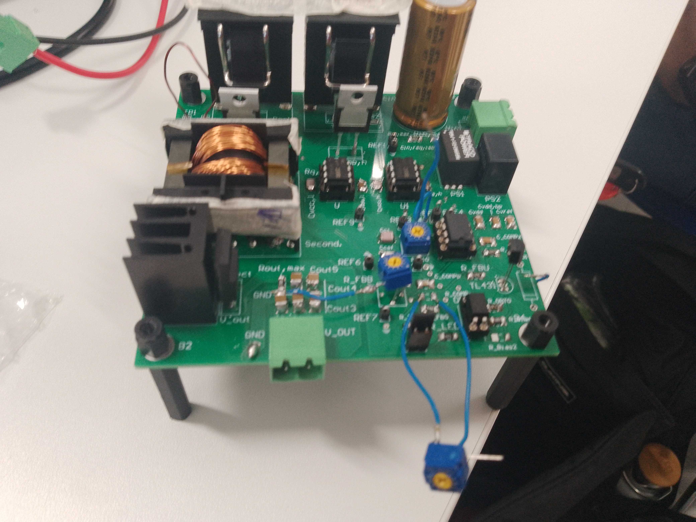
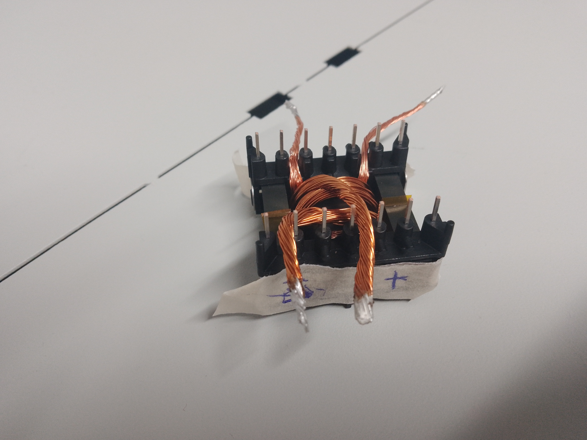
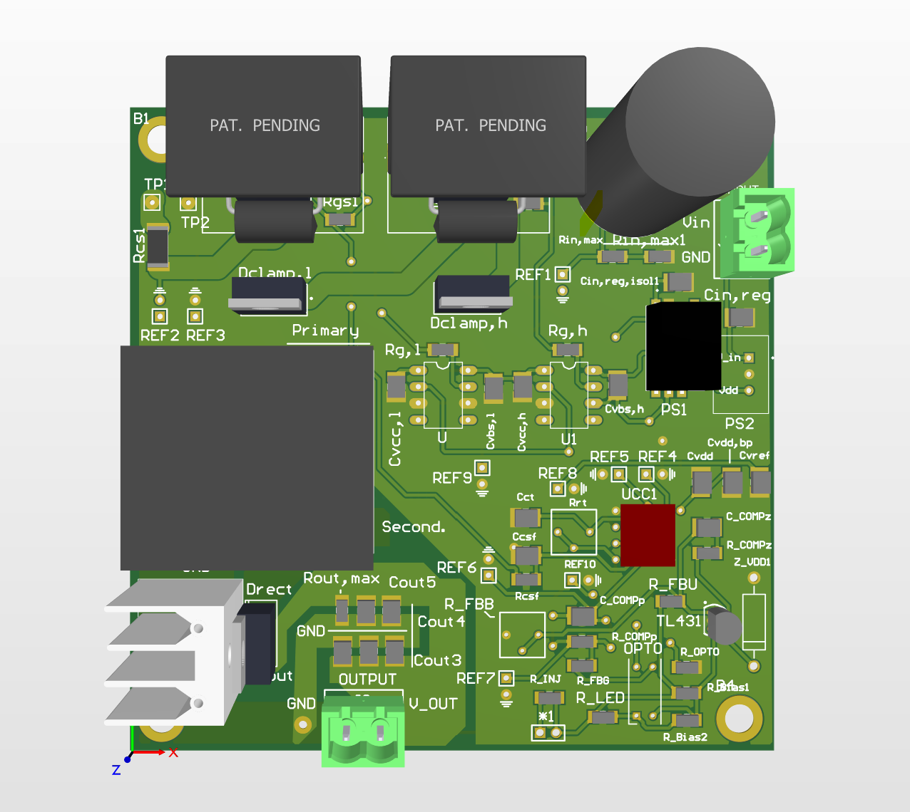

# Two Switch Flyback Converter
Design and implementation of a 50W dual-switch flyback power converter. Calculated components values, performed efficiency and stability analysis in MATLAB, and simulated the process in PLECS.

This was a project done for the "Power Electronics" course at EPFL.

Authors: Timothée Roth, Arkadiusz Rozmarynowicz.

Development time: from 02.2025 to 06.2025.

## Table of contents.
* [Converter parameters](#converter-parameters)
* [General information](#general-information)
* [Results](#results)
* [Technologies used](#technologies-used)

## Converter parameters.
- Nominal power: 50W
- Output voltage: 5V
- Input voltage: between 30V and 60V, with 50V nominal
- Switching frequency: 320kHz
- Max output voltage ripple: 2%

## General information.
- Calculated device parameters, such as:
    - duty cycle,
    - coupled inductor's winding ratio, dimensions
    - capacitor and resistor values,
    - MOSFETs and diodes parameters,
    - heatsink size.
- Simulated the circuit in PLECS. Analyzed:
    - compensation network's functioning,
    - impact of input voltage characteristics on output voltage.
- Simulated the system's stability and efficiency in MATLAB.
- Manually wound the coupled inductor.
- Measured the coupled inductor's characteristics, namely:
    - magnetizing and leakage inductance,
    - saturation current,
    - winding resistance.
<!-- - Tested the device for efficiency under a range of valid input voltages. -->

---

Below you can see relevant pictures and schematics. We needed to use potentiometers as some of the calculations turned out to be incorrect.

 
<em>Figure 1: Final PCB.</em>

 
<em>Figure 2: Coupled inductor: wound manually.</em>

 
<em>Figure 3: Idea schematic. Source: STMicroelectronics.</em>

 
<em>Figure 4: 3D view of the PCB.</em>

## Schematic
The schematic is visible in this file: [./Documents/Schematic.pdf](./Documents/Schematic.pdf)

## Results.
We struggled to get the compensation network working. As far as I remember, the feedback signal was either at 100% or at 0. We did, however, manage to get the converter working at 50V input and a small output current.

Although the converter did not work as expected, I gained thorough experience with the whole process, from schematic and calculations to testing. We believe we were just one calculation or one mis-soldered part away from a working power converter. I am now (autumn 2026) following another course in power electronics, where I study and experiment with other types of converters.

## Technologies used.
- Software:
    - Altium Designer
    - PLECS
    - MATLAB
- Measurement tools:
    - BODE100 analyser
    - Power choke meter
    - IR heat camera